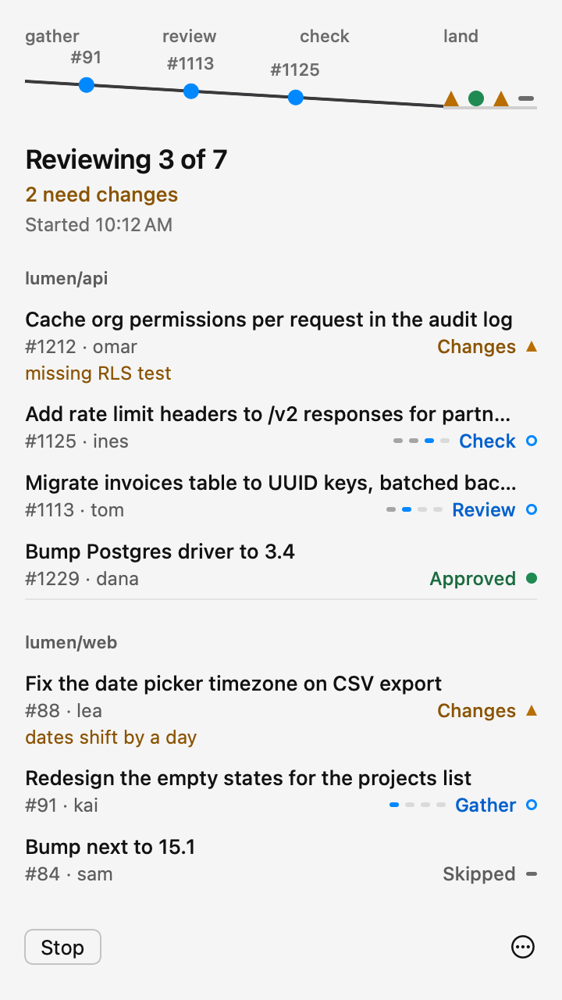
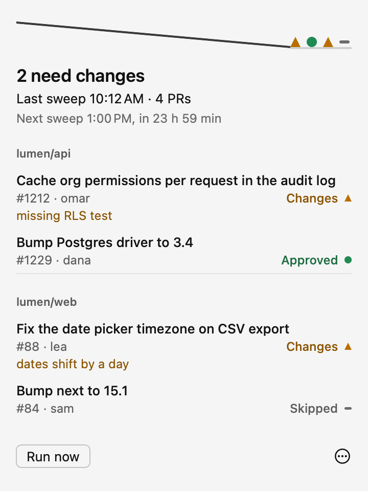
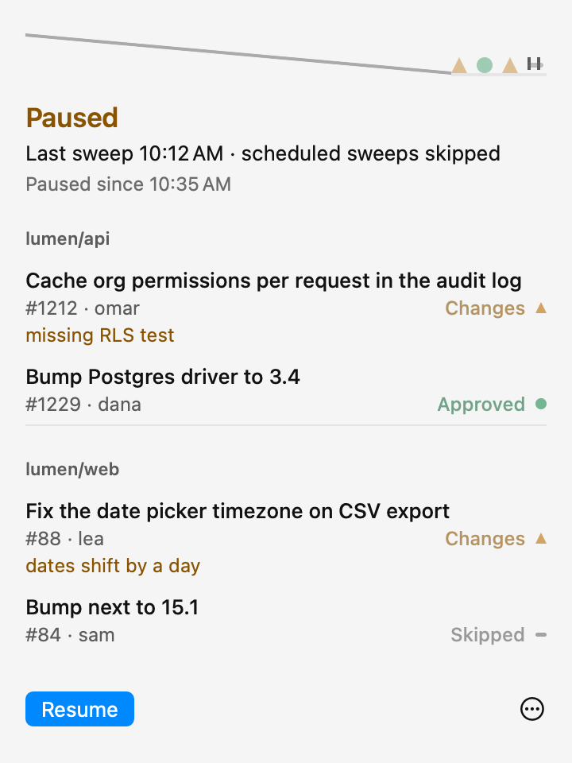
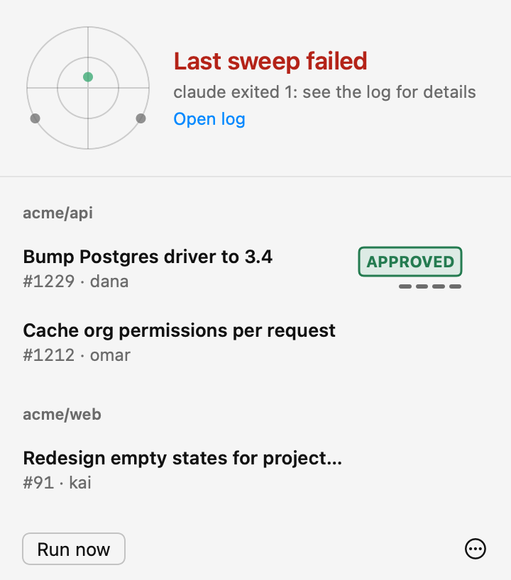

<p align="center">
  <picture>
    <source media="(prefers-color-scheme: dark)" srcset="assets/brand/wordmark-dark.png">
    
  </picture>
</p>

<p align="center"><strong>PRs reviewed before you're back.</strong><br>
Glidepath runs Claude Code reviews of your GitHub pull requests on a schedule
and shows them landing in your Mac's menu bar.</p>

```sh
brew install yznki/tap/glidepath
glidepath init
```

`init` checks your tools, asks which repos to watch, and does a dry run before anything is posted.

<p align="center">
  
</p>

## Safe on public repos

- Claude may run only Glidepath's own commands, each bound to the current run.
- A strict filter rejects any other shell command.
- Reads and writes stay inside the repo checkout and the run's scratch folder.
- GitHub tokens never reach the model.
- Only collaborators' PRs are reviewed, and reviews are posted as comments, by default.

Tested against one adversarial PR; see the transcript in [docs/security-test.md](docs/security-test.md). The full
design is in [docs/security.md](docs/security.md).

## Contents

- [How a run works](#how-a-run-works)
- [What it costs](#what-it-costs)
- [The menu bar app](#the-menu-bar-app)
- [Drafts](#drafts), [Dashboard](#dashboard), [Notifications](#notifications)
- [Config](#config)
- [Commands](#commands)
- [Your review rules](#your-review-rules)
- [Requirements](#requirements), [Install from source](#install-from-source), [Uninstall](#uninstall), [Limits](#limits), [Development](#development)
- [License](#license)

## How a run works

On each scheduled time, for each configured repo:

1. **Fetch and filter.** Updates a local checkout of the repo to its default branch. A checkout with local changes
   stops the run. Lists open PRs and skips your own PRs (unless `include_own = true`), drafts, bot authors, authors
   outside the allowed set, PRs you have already reviewed at the current head, and PRs over `max_changed_lines`.
   At most `max_prs_per_run` PRs are kept per repo. Each skip is recorded with its reason.
2. **Gather.** The `gatherer` agent (Haiku), one per PR, reads the diff and writes the PR's details and the blast
   radius: each caller of changed code outside the diff. It uses the GitNexus graph when it is on, and grep when not.
3. **Review.** The `reviewer` agent (Sonnet), one per PR, reviews the change against a written rubric. Over
   `split_over_lines`, the review is split into one reviewer per area. A UI reviewer also runs when the PR changes
   UI files.
4. **Check.** The `checker` agent (Sonnet), one per PR, re-opens every quoted line and drops any finding that does
   not match the code. It keeps verified blockers. If the checker changes the verdict or a finding, one more check
   runs on the fixed draft.
5. **Land.** One review per PR, posted as a comment by default. The comment's first line is the verdict. With
   `posting = "review"`, the review is APPROVE or REQUEST_CHANGES instead. With `posting = "draft"`, the review is
   held for you to post from the app or the CLI (see [Drafts](#drafts)).

Each run starts `claude -p` in the checkout with the `glidepath` skill. The skill gathers and reviews through the
steps above, and posts with `glidepath post`.

Glidepath is a single binary, `glidepath`. The scheduled job, the review skill and the menu bar app all come from that binary and the skill files it installs.

Results land in `~/.local/state/glidepath/runs/`. The menu bar app watches that folder and updates without polling.


## What it costs

A sandbox run on 2026-10-21 reviewed 2 PRs and used 106,804 tokens in 3 minutes 49 seconds. The PRs were +8 −1 in one
file (#1) and +10 −0 in one file (#2).

Glidepath uses three models, one per job:

- **Opus** runs the main session. It orchestrates the run and starts each step.
- **Haiku** gathers each PR: the diff, the existing comments, and the callers of changed code.
- **Sonnet** reviews each PR, and a second Sonnet pass checks each finding against the code.

Each PR is one or more Claude sessions: a gather step, a review per PR (more for large PRs, split by area), and a
checker. Costs grow with diff size and with how much of the repo the reviewer reads.

- The caps are the cost controls: `max_prs_per_run`, `max_changed_lines`, and the schedule itself. Lower them to
  bound a run.
- Each run records its total tokens, and each PR records the tokens of its own subagents. The menu bar app shows both.
  Tokens are input, output and cache writes; cache reads are not counted.
- Typical token use is not measured yet. Run the dry run on a repo you know, read the totals in the app, and set the
  caps from that.


## The menu bar app

The app follows [docs/design.md](docs/design.md). The header is an approach profile: a glide slope with four stage
labels (gather, review, check, land) and a runway on the right, where landed PRs park as marks. During a run, each
PR is a dot on the slope at the stage it is in.

<p align="center">
  
</p>

| Running | Idle, with changes |
| --- | --- |
| <picture><source media="(prefers-color-scheme: dark)" srcset="docs/shots/running-dark.png"></picture> | <picture><source media="(prefers-color-scheme: dark)" srcset="docs/shots/idle-changes-dark.png"></picture> |
| The sweep is in progress. Dots move down the slope; each row shows its stage and a four-dash meter. | The last sweep is done. Changes are listed first, with the review's reason. |
| **Paused** | **Failed** |
| <picture><source media="(prefers-color-scheme: dark)" srcset="docs/shots/paused-dark.png"></picture> | <picture><source media="(prefers-color-scheme: dark)" srcset="docs/shots/failed-dark.png"></picture> |
| Scheduled sweeps are skipped until you resume. Rows and marks are dimmed. | The last sweep did not finish. Rows carried over from an earlier sweep show when they were decided. |

- Header: the headline counts the sweep ("3 in flight, 4 landed"), the second line says what needs you ("2 need changes"),
  and the third gives the time. Other headlines are "All clear", "Last sweep failed" and "Paused".
- Rows: changes first, then no result, in flight (latest stage first), approved, and skipped. Each row has the PR
  title (one line), `#number · author`, and the status on the right. Changes rows also show the review's reason on a
  third line.
- Footer: Run now (or Resume while paused, or Stop while running) on the left, and a menu on the right with Pause,
  Open log, Open dashboard, the last run's token count, Open at login and Quit. On a first run, Edit repos… opens the config file.
- The popover is at most 640 pt tall. Past that, the list scrolls.
- Menu bar: a glyph echoing the app icon, a striped disc with a slot cut into it. A dot moves along the slot while
  running (with the count of active PRs), a count when changes are waiting (cleared when you open the popover), faded
  stripes while paused, and a cross at the touchdown point for a failed run. A small dot at the top right means a newer
  release is out.
- Footer menu: when a newer release is out, its first item is "Update to 1.1.0…". "Check for updates…" checks now.
- Stop signals the running sweep's process group. Reviews already posted stay posted; the PRs not yet reviewed show
  "No result".

Pause writes a marker file, so scheduled runs skip until you resume. Manual runs still work.

The app is the same binary as the CLI. Launched with no arguments, or with `app`, it opens the menu bar.


## Drafts

With `posting = "draft"`, a sweep runs the whole pipeline and checks each review exactly as `comment` or `review`
would, but holds it instead of posting. A held review is a draft. Its row shows the verdict, with **Post** and
**Discard** at the right of the second line, and the header says how many wait ("3 drafts to post").

- **Post** asks first, with the verdict and the start of the review. It runs `glidepath drafts post`, which checks the
  stored review again, fetches the PR, and refuses if its head has moved since the review. A refused draft is marked
  stale, and the next sweep reviews the PR again. A post that works removes the draft.
- **Discard** deletes the draft. The row keeps its verdict.
- From a terminal: `glidepath drafts list`, `glidepath drafts post owner/name N` and `glidepath drafts discard owner/name N`
  act on the newest open draft for that PR. Review sessions cannot run these commands.

Drafts are kept under `~/.local/state/glidepath/drafts/`, one file per PR and run.

## Reviewing a large PR

A PR over `max_changed_lines` is skipped by sweeps and its row reads "Too large · 12,480 lines". Its **Review** action
(line 2, right) asks first, with the size, the limit and, when the last run allows it, a rough token estimate. It runs
`glidepath review owner/name N`, which reviews that PR alone and follows `posting` as usual.

## Dashboard

`glidepath dashboard`, or Open dashboard in the menu, writes one page to `~/.local/state/glidepath/dashboard/index.html`
and opens it in your browser. It shows the open drafts, with their full text and the command that posts each one, then
the last 50 runs: date, duration, tokens, and each PR's title, number (linked on GitHub), author, verdict and reason.
The page has no script. Every string from GitHub or the model is escaped, and it follows light and dark mode.

## Notifications

When a sweep finishes, Glidepath posts one notification: "Sweep done" with the counts ("2 need changes · 3 approved",
"All clear · 5 reviewed", or "3 drafts to post"), or "Sweep failed" with the run's error. A sweep with no PRs reviewed
says nothing, and a dry run never notifies. Clicking the notification opens the popover. The first launch after an
update asks for permission. If it is denied, the app logs that once and carries on.

Turn notifications off with `notify = false` in the config. The app has no menu item for this; the config is the
one place to change it.

## Config

`~/.config/glidepath/config.toml`:

```toml
schedule = ["07:00", "13:00", "19:00"]   # global; one launchd job
check_updates = true          # false turns off the automatic check for new releases
notify = true                 # false turns off the notification when a sweep finishes

[limits]
max_prs_per_run = 10
max_changed_lines = 3000      # bigger PRs are skipped with reason "too large"
split_over_lines = 1500       # reviews are split by area above this

[[repo]]
slug = "acme/api"
clone = "~/glidepath/clones/acme-api"   # init clones a dedicated detached checkout
posting = "comment"           # comment | review | draft
authors = "collaborators"     # collaborators | anyone | ["login", ...]
rules = "~/.config/glidepath/rules/acme-api.md"   # optional
rules_mode = "extend"         # extend | replace
gitnexus = "auto"             # auto | on | off
gitnexus_refresh = true       # re-index the clone before a sweep that reviews something (GitNexus on only)
include_own = false           # true to review your own PRs too
flag_paths = ["infra/", ".github/workflows/"]   # optional: PRs touching these get a note
flag_note = "Needs a devops code-owner approval."  # optional: the note text
```

| Key | Default | Meaning |
| --- | --- | --- |
| `schedule` | `07:00`, `13:00`, `19:00` | Local times for scheduled runs. One launchd job for all repos. |
| `check_updates` | `true` | Check GitHub for a newer release at launch, daily and when the popover opens. `false` turns those checks off; "Check for updates…" still works. |
| `notify` | `true` | Notify when a sweep finishes. See [Notifications](#notifications). |
| `limits.max_prs_per_run` | `10` | PRs per repo per run. Extra PRs are skipped with reason "over max_prs_per_run". |
| `limits.max_changed_lines` | `3000` | Additions plus deletions above this are skipped with reason "too large". |
| `limits.split_over_lines` | `1500` | Above this, the review is split into one reviewer per area. |
| `repo.slug` | required | `owner/name` on GitHub. |
| `repo.clone` | `~/glidepath/clones/<owner>-<name>` | Detached checkout the skill reads. Never used for work. |
| `repo.posting` | `comment` | `comment` posts a COMMENT review whose first line is `Verdict: approve` or `Verdict: changes`. `review` posts APPROVE or REQUEST_CHANGES. `draft` holds the review until you post it; see [Drafts](#drafts). |
| `repo.authors` | `collaborators` | `collaborators` means write, maintain or admin access on the repo. `anyone` means any author. A list means only those logins. |
| `repo.rules` | none | A Markdown file with extra review rules for this repo. |
| `repo.rules_mode` | `extend` | `extend` adds the file to the built-in rubric. `replace` swaps out the rubric's review bar. Safety and output sections always apply. |
| `repo.gitnexus` | `auto` | Use the GitNexus MCP tools for blast radius. `auto` uses them when the `gitnexus` command is on your PATH and `authors` is not `"anyone"`. Otherwise the skill uses grep. |
| `repo.gitnexus_refresh` | `true` | Before a sweep that reviews something, run `gitnexus analyze --index-only` in the clone (10-minute limit). If that fails or times out, GitNexus is off for this repo in this run. Has no effect when GitNexus is off. |
| `repo.include_own` | `false` | Review PRs you opened too. Off by default. GitHub accepts only a COMMENT review on your own PR, so `post` sends COMMENT for those whatever `posting` says. |
| `repo.flag_paths` | none | Path prefixes that need an extra approval. A PR whose changed files start with one gets a final line on its review: the note, and up to three matched paths. The verdict does not change, and the row shows "Flagged". |
| `repo.flag_note` | "Touches flagged paths; needs an extra approval." | The text of that note. Used only with `flag_paths`. |

Edits take effect on the next run. `glidepath doctor` checks the file.

### Testing without touching your config

`XDG_CONFIG_HOME` and `XDG_STATE_HOME` (absolute paths only) move Glidepath's own config and state folders, for
example for a sandboxed test run. HOME is not changed, so claude and gh keep their sign-in (the runner also pins gh's
config directory to `~/.config/gh`).


## Commands

| Command | What it does |
| --- | --- |
| `glidepath init` | Set up config, clones, skill, app link and schedule. Ends with a dry run. |
| `glidepath init --refresh` | Re-link the skill, app and schedule to the installed binary. No prompts, no dry run. `update` runs it after an upgrade. |
| `glidepath update` | Upgrade a Homebrew install to the latest release. See [Updating](#updating). |
| `glidepath run [--dry-run] [--repo owner/name]` | Run now. `--dry-run` reviews and posts nothing. |
| `glidepath state show [--run ID]` | Print a run as JSON. Defaults to the current run. |
| `glidepath pr info` / `pr diff` / `pr threads` / `post` | Used by the review session. Run them only inside a run; see [docs/security.md](docs/security.md). |
| `glidepath review owner/name N [--dry-run] [--again]` | Review one open PR now, including one over `max_changed_lines`. Other filters still apply; an already reviewed head is skipped unless `--again`. Refused while a run is in progress. |
| `glidepath drafts list` / `post owner/name N` / `discard owner/name N` | List, post or discard held reviews. See [Drafts](#drafts). |
| `glidepath dashboard` | Write the dashboard page and open it. See [Dashboard](#dashboard). |
| `glidepath pause` / `resume` | Skip or allow scheduled runs. |
| `glidepath doctor` | Check requirements and installed pieces. |
| `glidepath uninstall [--purge]` | Remove the schedule, skill and app link. `--purge` also removes config and state. |

`state set` (`--run`, `--repo`, `--pr`, `--stage gather|review|check`, `--reason`) and the `pr` and `post` commands are
used by the review session and refuse to run outside one.


## Your review rules

A repo can add a Markdown rules file with `rules`, and `rules_mode` chooses how it combines with the built-in rubric
(`extend` or `replace`). The rules file is read by the reviewer and may be quoted in public comments, so keep secrets,
tokens, internal hostnames and private data out of it.


## Requirements

- macOS 14 or later, Apple Silicon or Intel.
- Xcode Command Line Tools (`xcode-select --install`).
- `git`, from the Command Line Tools.
- `gh`, the GitHub CLI, signed in with the `repo` scope (`gh auth login`, or `gh auth refresh -s repo`).
- `claude`, Claude Code 2.1.306 or later, logged in. Install with `brew install --cask claude-code`.
- GitNexus is optional. See [Config](#config) for `gitnexus`.

`glidepath init` checks each of these and prints the fix command for any that is missing. Claude Code 2.1.306 or later
is needed because the session flags in [docs/security.md](docs/security.md) were checked against that version. A gh
token with the `repo` scope is needed for private repos.

## Install from source

```sh
git clone https://github.com/yznki/glidepath.git
cd glidepath
swift build -c release
./make-app.sh --no-build      # optional: builds build/Glidepath.app
.build/release/glidepath init
```

`swift build` needs only the Command Line Tools. `swift test` needs the full Xcode toolchain, because the Command Line
Tools do not include XCTest.

## init walkthrough

`glidepath init` does these steps in order and stops at the first failed requirement:

1. **Requirements.** Checks Command Line Tools, `git`, `gh`, `gh` sign-in and `claude`.
2. **Config.** If there is no config yet, asks for a repo as `owner/name` (or takes `--repo owner/name`)
   and writes `~/.config/glidepath/config.toml` with the defaults. An existing config is kept.
3. **Clone.** Clones each repo with `gh repo clone` into its `clone` path and detaches it at the default branch.
4. **Skill.** Copies `SKILL.md` and `rubric.md` to `~/.claude/skills/glidepath/`.
5. **App.** Links `Glidepath.app` into `~/Applications/`. Skipped if the app is not next to the binary.
6. **Schedule.** Writes `~/Library/LaunchAgents/dev.glidepath.run.plist` and loads it with
   `launchctl bootstrap`. The plist runs `glidepath run --scheduled` at each `schedule` time, with
   the `PATH` from the shell you ran `init` in. If you change tools later (for example, move `gh`),
   run `init` again.
7. **Dry run.** Runs `glidepath run --dry-run` on the first repo. It reviews, prints the drafts,
   and posts nothing.

After the dry run, open the menu bar app and check the output. Posting starts at the next scheduled time.

## Updating

A newer release shows as a line above the footer, with a link to its notes, and as a dot on the menu bar glyph.
For a Homebrew install, "Update to 1.1.0…" in the footer menu (or `glidepath update`) runs `brew update` and
`brew upgrade yznki/tap/glidepath`, then refreshes the skill, app link and schedule. Homebrew rebuilds from source, so
expect about a minute. The menu bar app restarts itself when it is done. If a sweep is running, the update waits for it
to end. A source build is not updated in place: the update opens the release page instead.

Upgrading from 1.0.2: run `brew upgrade yznki/tap/glidepath`, then `glidepath init --refresh` once.

```sh
glidepath update              # checks now; upgrades a Homebrew install
glidepath update --wait       # same, but waits for a running sweep to end first
```

Automatic checks can be turned off with `check_updates = false` in the config.

## Uninstall

```sh
glidepath uninstall          # removes the schedule, skill and app link; keeps config and state
glidepath uninstall --purge  # also removes config and state
brew uninstall glidepath     # removes the binary and app
```

Clones under `~/glidepath/clones/` are not removed. Delete them yourself if you no longer need them.

## Limits

- macOS only. The menu bar app needs AppKit and SwiftUI.
- GitHub only. The CLI calls `gh` and the GitHub REST API.
- Per-PR token totals include only the subagents the skill starts for that PR. They are attributed by the PR number in
  each subagent's brief. Main-session tokens count toward the run total only.

## Development

```sh
swift build                                        # Command Line Tools are enough
DEVELOPER_DIR=/Applications/Xcode.app/Contents/Developer swift test   # XCTest needs Xcode
./make-app.sh                                      # release build and app bundle
```

The app has two render modes that need no UI. `glidepath --snapshot <dir>` draws the design states from fixtures to
PNG files, light and dark, plus the menu bar glyphs. `glidepath --hero-gif <path>` writes the hero animation as a
looping GIF, with injected time.

CI runs `swift build` and `swift test` on macOS.


## License

MIT. See [LICENSE](LICENSE).
